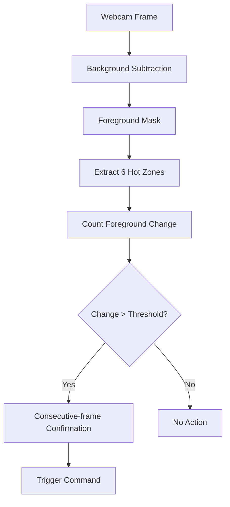

# HW4 — Vision-Based UI using Background Subtraction

## 0. 作業題目

Vision-Based UI using Background Subtraction

本作業使用 Background Subtraction 建立 Vision-Based Touchless Document Reader。

共用系統介面請參考：

`Touchless_Document_Reader_UI.md`

---

## 1. 作業目的

1. 使用電腦攝影機取得即時畫面。
2. 使用 Background Subtraction 偵測畫面變化。
3. 只在指定 Hot Zones 中計算 foreground change amount。
4. 當區域內變化量超過 threshold 時，觸發對應閱讀器指令。
5. 分析 threshold 與環境光線變暗對操作穩定性的影響。

本作業不可使用 HW5 的 Hand Detection 方法。

---

## 2. 系統介面

使用 `Touchless_Document_Reader_UI.md`。

共 6 個 Zones：
- Z1：Previous Page
- Z2：Next Page
- Z3：Zoom In
- Z4：Zoom Out
- Z5：Menu
- Z6：Settings

---

## 3. 辨識原理



可使用 OpenCV Background Subtractor，例如 `cv2.createBackgroundSubtractorMOG2()`。

對每個 Zone 計算：

```text
motion_ratio = changed_pixels / zone_area
```

由於不同 Zone 大小不同，正式 threshold 判斷建議用 motion ratio，而不是 absolute pixel count。

單一 frame 超過 threshold 不立即執行，加入：
```text
motion_ratio > threshold
for K consecutive frames
→ trigger
```

建議初始：
```text
K = 3
Cooldown = 1.0 second
```

---

## 4. HW4 禁止使用

- MediaPipe Hands
- Hand landmarks
- Wrist detection
- Hand center
- Skin-color segmentation
- YOLO / Object Detection 辨識手
- HW5 的 Hand Detection 邏輯

HW4 中程式不知道進入 Zone 的物體是不是手，只判斷 foreground change。

---

## 5. Experiment 1 — 6 Commands Basic Accuracy

### 目的
確認 6 個 Hot Zones 是否能正常觸發正確指令。

### 條件
- Normal Lighting
- 固定 baseline threshold
- 每個 command 測 5 次

總計：
```text
6 × 5 = 30 trials
```

### 記錄
- trial_id
- target_zone
- target_command
- triggered_zone
- triggered_command
- correct
- motion_ratio
- trigger_time_ms
- false_trigger

### Metrics
- Overall Success Rate
- Per-command Success Rate
- False Trigger Count
- Mean Trigger Time

---

## 6. Experiment 2 — Threshold Test

### 目的
分析 Background Subtraction threshold 對觸發結果的影響。

### Representative Commands
- Previous
- Next
- Zoom In

### Threshold Conditions
先做 Pilot，觀察正常操作的 motion ratio 分布，再定三組：
- Low
- Medium
- High

不要先硬編固定 pixel threshold。

### Repetitions
```text
3 commands × 3 threshold settings × 3 repetitions
= 27 trials
```

### Metrics
- Success Rate
- False Trigger
- Missed Trigger
- Mean Trigger Time

---

## 7. Experiment 3 — Lighting Interference Test

### 目的
分析環境變暗是否影響 Background Subtraction-based interaction。

環境干擾統一只測：
- Normal Lighting
- Dim Lighting

不測背景人物、背景物體移動或多人干擾。

### Representative Commands
- Previous
- Next
- Zoom In

### Repetitions
```text
3 commands × 2 lighting conditions × 3 repetitions
= 18 trials
```

### Metrics
- Success Rate
- False Trigger
- Missed Trigger
- Mean Motion Ratio
- Mean Trigger Time

---

## 8. HW4 實驗總量

```text
Experiment 1 = 30
Experiment 2 = 27
Experiment 3 = 18
Total = 75 trials
```

---

## 9. Screenshots

至少保留：
1. 完整 Document Reader UI
2. Foreground Mask
3. Previous Zone 被觸發
4. Next Zone 被觸發
5. Bottom Toolbar Zone 被觸發
6. Normal Lighting
7. Dim Lighting
8. False Trigger 或 Missed Trigger（若有）

---

## 10. 書面報告架構

### 1. 目的
說明 Vision-Based UI、Background Subtraction、Hot Zones、Touchless Document Reader 與實驗目的。

### 2. 辨識原理、程式碼撰寫重點
至少包含：
- Background Model / Foreground Mask
- 6 Hot Zones
- ROI extraction
- motion ratio
- Threshold
- Consecutive Frames
- Cooldown
- 6 Commands Mapping

並明確指出 HW4 未使用任何 Hand Detection 技術。

### 3. 介面與實驗設計
介面引用 `Touchless_Document_Reader_UI.md`。

實驗包含：
1. 6 Commands Basic Accuracy
2. Threshold Test
3. Normal vs Dim Lighting

### 4. 實驗結果與討論
至少包含：
- Overall / Per-command Accuracy
- Low / Medium / High Threshold
- False Trigger / Missed Trigger
- Normal vs Dim Lighting
- Error Cases
- Background Subtraction 的優點與限制

---

## 11. 最終 Checklist

- [ ] 使用共用 Document Reader UI
- [ ] 6 Hot Zones
- [ ] Background Subtraction
- [ ] Hot-Zone foreground change calculation
- [ ] Threshold
- [ ] Consecutive-frame confirmation
- [ ] Cooldown
- [ ] 不使用 Hand Detection
- [ ] Experiment 1 完成
- [ ] Experiment 2 完成
- [ ] Experiment 3 完成
- [ ] Screenshots
- [ ] Report 至少包含四大章節
