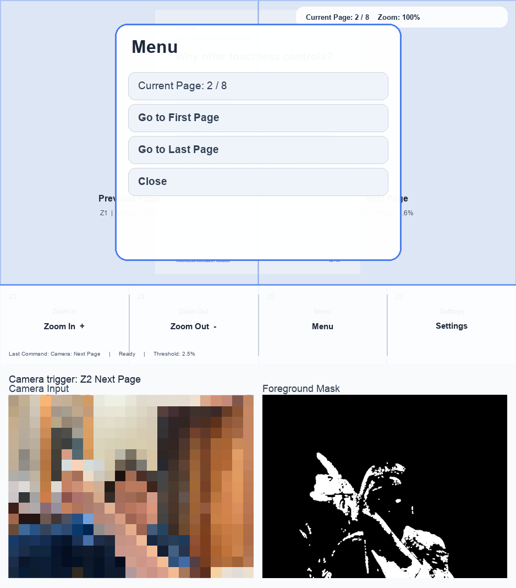
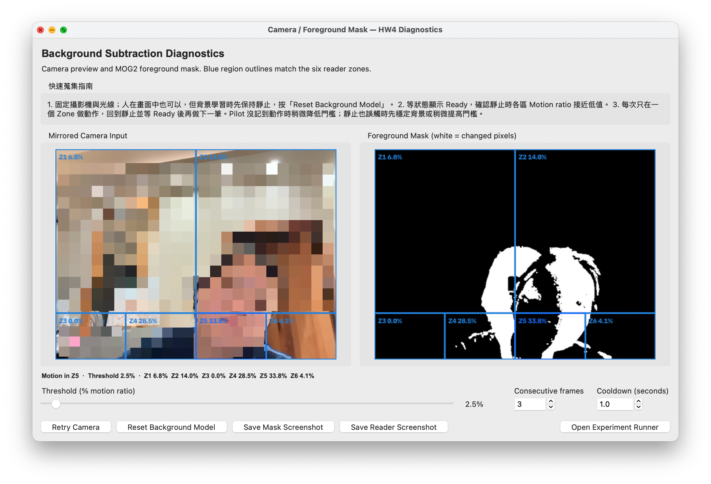
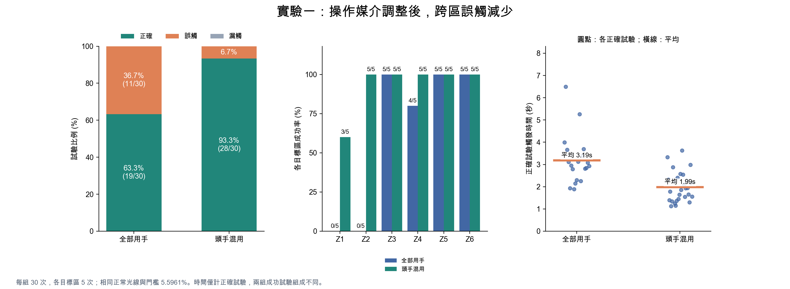
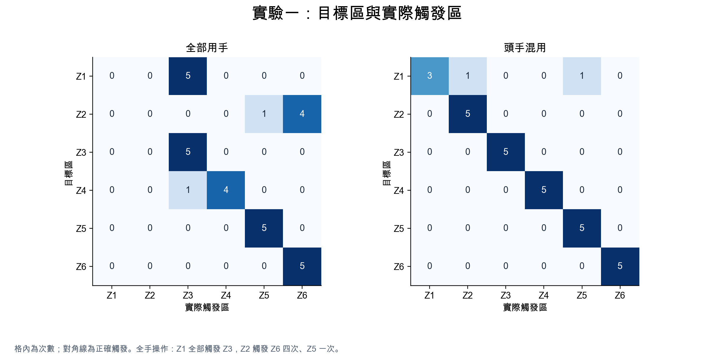
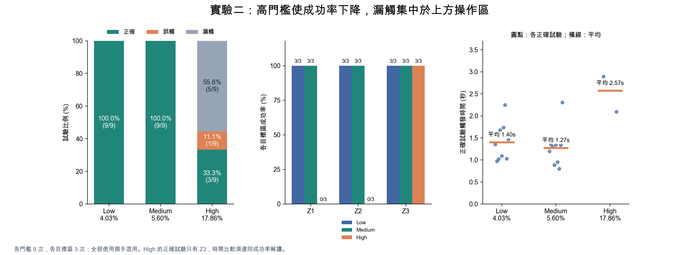
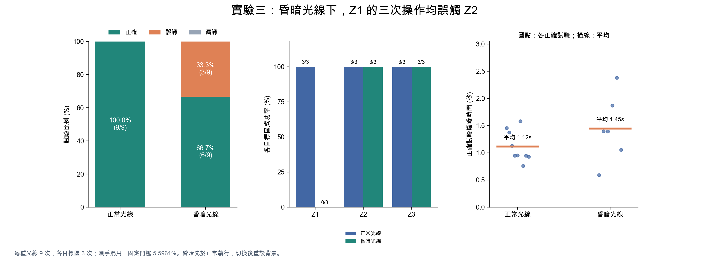

# 作業四：以背景減除實作非接觸式文件閱讀器

## 摘要

本作業以電腦攝影機與 OpenCV MOG2 背景減除建立 Vision-Based Touchless Document Reader。系統將攝影機影像分為六個操作區域，計算各區前景變化比例，透過門檻、連續影格確認與冷卻時間觸發上一頁、下一頁、放大、縮小、選單及設定。實驗涵蓋基本指令準確度、門檻設定與正常／昏暗光線，共完成 105 次試驗，其中包含基本準確度的兩種操作媒介比較。

全手操作的成功率為 63.3%，改為 Z1／Z2 使用頭部、其餘區域使用手後提升至 93.3%，誤觸由 11 次減為 2 次。後續以頭手混用進行門檻與光線實驗：Low 與 Medium 門檻皆達 100% 成功率，High 為 33.3%；正常光線成功率為 100%，昏暗光線為 66.7%。結果顯示，本次互動品質同時受到操作媒介、區域位置、門檻及光線條件影響。

程式原始碼可參考：https://github.com/tzuuuu/nccu_HCI_hw4_background-subtraction

## 一、作業目的

本作業的目標是利用攝影機畫面的變化，建立可操作文件閱讀器的非接觸式視覺介面。使用者不需直接碰觸畫面，即可在指定 Hot Zones 中移動，讓系統執行對應指令。

實作與評估聚焦於三個問題：

1. 六個操作區域能否正確觸發閱讀指令？操作媒介是否影響跨區誤觸？
2. 前景變化比例門檻的高低，如何影響成功、誤觸與漏觸？
3. 在背景重新穩定後，昏暗光線是否影響辨識結果？

本作業只使用 Background Subtraction 判斷前景變化，未使用 MediaPipe Hands、手部關鍵點、手腕或手部中心偵測、皮膚色分割、YOLO 或其他手部偵測技術。頭部與手部是使用者選擇的操作媒介，程式本身不辨識身體部位。

## 二、辨識原理與程式實作

### 2.1 從攝影機畫面到前景遮罩

系統使用 Python、OpenCV、Tkinter 與 Pillow。攝影機影像先水平鏡像，讓預覽的左右方向符合操作感受，再調整為 640 × 480 像素進行處理。MOG2 依畫面建立並更新背景模型，產生 Foreground Mask，表示相對於背景模型的前景變化。

程式的 MOG2 設定為 `history=500`、`varThreshold=24`、`detectShadows=True`。接著保留遮罩值大於 200 的像素，排除被標為陰影的像素，再以 3 × 3 核心做形態學開運算，減少零散雜訊。背景模型初始或重設後先學習 45 個影格，期間不觸發指令。

處理流程如下：

```text
攝影機影像 → 鏡像及尺寸調整 → MOG2 背景減除
→ 前景遮罩與雜訊處理 → 擷取六個 ROI
→ 計算各區 motion ratio → 門檻與連續影格確認
→ 冷卻／釋放判斷 → 觸發對應閱讀指令
```

### 2.2 ROI 與前景變化比例

攝影機影像依閱讀器相同的比例切成六個感興趣區域（ROI）。每個區域計算：

```text
motion_ratio = 該 ROI 的前景像素數 / 該 ROI 的總像素數
```

採用比例可將門檻表示為區域中有多少百分比發生變化。例如 5.60% 代表該區約有 5.60% 的像素被判為前景。它描述的是相對於背景模型的變化，不是手或頭的面積估計，也不是單純比較相鄰兩張影像。

### 2.3 連續影格確認、冷卻與重新啟用

單一影格超過門檻不會立即觸發。系統要求同一區連續 K 個影格滿足 `motion_ratio >= threshold`；程式預設 K = 3，並設置 1 秒的全域冷卻時間。若同時有多個區域完成確認，選擇當下 motion ratio 最大者觸發。

觸發後，該區須連續三個影格低於釋放門檻，才可再次觸發；釋放門檻為 `max(0.004, threshold × 0.45)`。這可減少同一段持續動作反覆執行指令。診斷狀態區分背景學習、區域變化、等待動作釋放、冷卻與 Ready，協助使用者判斷何時適合進行下一筆操作。


### 2.4 程式架構

程式原始碼可參考：https://github.com/tzuuuu/nccu_HCI_hw4_background-subtraction

| 程式 | 負責功能 |
|---|---|
| `background_subtraction.py` | 攝影機擷取、MOG2、ROI、motion ratio 與觸發判斷 |
| `reader_ui.py` | 文件頁面、六區介面、指令執行與視覺回饋 |
| `app.py` | 連接辨識與閱讀器，提供診斷視窗及截圖功能 |
| `experiment_runner.py` | Pilot、試驗排程、條件準備、計時與 CSV 記錄 |
| `analyze_experiments.py` | 讀取實際 CSV、驗證資料、計算指標並以 Matplotlib 繪圖 |

## 三、介面與實驗設計

### 3.1 文件閱讀器與診斷介面

閱讀器使用八張 PNG 文件頁面，避免將實作重心轉移至 PDF 解析。閱讀區占畫面上方 78%，左半部與右半部分別控制上一頁及下一頁；底部 22% 為四格工具列。攝影機畫面的六區亦採相同比例。

| Zone | 位置 | 指令 |
|---|---|---|
| Z1 | 上方閱讀區左半部 | Previous Page |
| Z2 | 上方閱讀區右半部 | Next Page |
| Z3 | 下方工具列第 1 格 | Zoom In |
| Z4 | 下方工具列第 2 格 | Zoom Out |
| Z5 | 下方工具列第 3 格 | Menu |
| Z6 | 下方工具列第 4 格 | Settings|

介面顯示 Current Page、Zoom、Last Command 與各區變化比例，區域在接近觸發或觸發時加強視覺回饋。攝影機預覽與前景遮罩可用來觀察變化發生的位置，協助區分目標動作與其他身體移動。



**圖 1　文件閱讀器介面介紹。** 上方為八頁文件閱讀器與六個操作區域，圖中開啟 Menu，可跳至第一頁、最後一頁或關閉選單；下方並列攝影機影像與前景遮罩。攝影機影像已做像素化處理。此圖是介面示例，顯示初期 2.5% 門檻，正式實驗一與三的門檻以 CSV 記錄的 5.5961% 為準。（左下方人像因隱私問題製作馬賽克遮罩）



**圖 2　背景減除診斷介面。** 左側顯示鏡像攝影機畫面及六個操作區的即時比例，右側顯示 MOG2 前景遮罩；下方可調整動作門檻、連續影格數與冷卻時間，並重設背景模型或開啟 Experiment Runner。此截圖呈現操作介面與當下影像狀態，比例值不是正式試驗的彙整結果。

### 3.2 Pilot 與門檻選擇

Pilot 在正常光線下收集 32 筆實際觸發樣本，當時門檻為 2.5%。以 motion ratio 的第 25、50、75 百分位數推導 Low、Medium、High 建議值，正式實驗二使用四捨五入後的百分比設定。

| Pilot 樣本數 | 第 25 百分位 | 第 50 百分位 | 第 75 百分位 |
|---:|---:|---:|---:|
| 32 | 4.0286% | 5.6044% | 17.85695% |

| 正式條件 | Threshold |
|---|---:|
| Experiment 1／3 固定基準 | 5.60% |
| Experiment 2 Low | 4.03% |
| Experiment 2 Medium | 5.60% |
| Experiment 2 High | 17.86% |


### 3.3 操作媒介的調整

原先規劃以手操作六區。實際蒐集時發現，為了將手移到攝影機畫面上方的 Z1／Z2，容易伴隨較大幅度的手臂與身體移動，並誤觸其他區域。因此實驗一保留兩份資料，進行探索性的設計比較：

1. **全部用手：** 六區均以手操作，共 30 次。
2. **頭手混用：** Z1／Z2 使用頭部，Z3／Z4／Z5／Z6 使用手，共 30 次。

實驗二與三均採調整後的頭手混用方式。系統辨識流程維持背景減除，未加入頭部或手部辨識；這項調整改變的是使用者的操作策略。

### 3.4 三組實驗與資料量

| 實驗 | 條件 | 目標指令 | 重複次數 | 正式試驗數 |
|---|---|---|---:|---:|
| 實驗一：基本準確度及媒介比較 | 正常光線、固定門檻，全部用手／頭手混用 | 六個指令 | 每種媒介、每指令 5 次 | 60 |
| 實驗二：門檻比較 | 正常光線，Low／Medium／High，頭手混用 | Previous、Next、Zoom In | 每指令、每門檻 3 次 | 27 |
| 實驗三：光線比較 | 正常／昏暗光線、固定門檻，頭手混用 | Previous、Next、Zoom In | 每指令、每光線 3 次 | 18 |
| **總計** | | | | **105** |

正式資料共 105 次。Pilot 的 32 筆另計，不納入正式成功率。

Runner 先顯示目標區與條件，使用者確認準備好後才啟動單次試驗計時。實驗三在切換光線後先重設背景模型，等待背景穩定，再按下開始計時；調光與背景學習時間不列入觸發時間。每筆試驗以第一個觸發區判定結果，預設 8 秒內未觸發則記為漏觸。


## 四、實驗結果與討論

### 4.1 實驗一：頭手混用減少跨區誤觸

| 操作方式 | 正確／總數 | 成功率 | 誤觸 | 漏觸 | 所有已觸發平均時間（秒） | 正確觸發平均時間（秒） |
|---|---:|---:|---:|---:|---:|---:|
| 全部用手 | 19／30 | 63.3% | 11 | 0 | 2.773 | 3.193 |
| 頭手混用 | 28／30 | 93.3% | 2 | 0 | 1.944 | 1.991 |

頭手混用的成功率較全手操作增加 **30%**；誤觸由 11 次降至 2 次，減少 9 次，相對減少 **81.8%**。兩組均無漏觸，主要差異是觸發到錯誤區域的次數。

| 目標區 | 全部用手正確／總數 | 頭手混用正確／總數 |
|---|---:|---:|
| Z1：Previous | 0／5 | 3／5 |
| Z2：Next | 0／5 | 5／5 |
| Z3：Zoom In | 5／5 | 5／5 |
| Z4：Zoom Out | 4／5 | 5／5 |
| Z5：Menu | 5／5 | 5／5 |
| Z6：Settings | 5／5 | 5／5 |

改善主要集中於上方閱讀區。全手操作的 Z1 五次全部誤觸 Z3；Z2 五次則誤觸 Z6 四次、Z5 一次。混用後 Z2 五次均正確，Z1 仍有兩次誤觸，分別觸發 Z2 與 Z5。下方四區原本已大多能正確操作，混用組四區皆為 5／5。



**圖 3　實驗一兩種操作方式的結果。** 左圖為正確、誤觸及漏觸比例；中圖為各目標區成功率，標籤為正確次數／總次數；右圖為正確試驗的觸發時間。兩組各 30 次，使用相同光線條件與固定門檻。



**圖 4　實驗一混淆矩陣。** 橫軸是實際觸發區，縱軸是目標區，格內為次數，對角線表示正確觸發。全手操作的上方目標常先觸發下方工具列。

操作時觀察到，手移向上方區域會帶動其他身體部位，增加跨區前景變化。改用頭部控制上方兩區後，本次誤觸明顯減少。

區域幾何也可能影響此現象：單一上方區域約占畫面 39%，單一工具列區域約占 5.5%。若兩區出現相同數量的變化像素，工具列區的 motion ratio 會約為上方區的 7.09 倍。依版面比例推導，在使用統一比例門檻時，移動路徑若經過較小區域，可能使其他指令先完成觸發。


### 4.2 實驗二：過高門檻導致上方區域漏觸

| 門檻條件 | 正確／總數 | 成功率 | 誤觸 | 漏觸 | 所有已觸發平均時間（秒） | 正確觸發平均時間（秒） | 正確試驗平均 motion ratio |
|---|---:|---:|---:|---:|---:|---:|---:|
| Low：4.03% | 9／9 | 100.0% | 0 | 0 | 1.400 | 1.400 | 8.852% |
| Medium：5.60% | 9／9 | 100.0% | 0 | 0 | 1.274 | 1.274 | 10.455% |
| High：17.86% | 3／9 | 33.3% | 1 | 5 | 3.700 | 2.572 | 24.167% |

| 目標區 | Low 正確／總數 | Medium 正確／總數 | High 正確／總數 |
|---|---:|---:|---:|
| Z1：Previous | 3／3 | 3／3 | 0／3 |
| Z2：Next | 3／3 | 3／3 | 0／3 |
| Z3：Zoom In | 3／3 | 3／3 | 3／3 |

Low 與 Medium 在本次操作下均為 9／9 正確。High 只保留 Z3 的三次正確操作；Z1 為兩次漏觸、一次誤觸 Z5，Z2 三次全部漏觸。High 的五次漏觸，目標區最大 motion ratio 約為 11.41%–17.82%，均未達 17.86%，支持門檻過高排除自然操作的解釋。



**圖 5　實驗二門檻比較。** 每個門檻各九次，三個目標區各三次。High 的漏觸集中於 Z1／Z2；右圖 High 的正確觸發時間只有 Z3 樣本，須與成功率一起解讀。

Medium 的正確觸發平均時間較 Low 短約 0.126 秒，但兩者成功率相同，而 High 則是對上方 z1/z2 兩區過於嚴格，導致成功率只有33.3%。

### 4.3 實驗三：昏暗條件的錯誤集中於 Z1

| 光線條件 | 正確／總數 | 成功率 | 誤觸 | 漏觸 | 所有已觸發平均時間（秒） | 正確觸發平均時間（秒） | 正確試驗平均 motion ratio |
|---|---:|---:|---:|---:|---:|---:|---:|
| 正常光線 | 9／9 | 100.0% | 0 | 0 | 1.119 | 1.119 | 13.631% |
| 昏暗光線 | 6／9 | 66.7% | 3 | 0 | 1.288 | 1.448 | 15.453% |

| 目標區 | 正常光線正確／總數 | 昏暗光線正確／總數 | 正常正確平均時間（秒） | 昏暗正確平均時間（秒） |
|---|---:|---:|---:|---:|
| Z1：Previous | 3／3 | 0／3 | 1.029 | — |
| Z2：Next | 3／3 | 3／3 | 1.152 | 1.882 |
| Z3：Zoom In | 3／3 | 3／3 | 1.177 | 1.013 |

正常光線成功率為 100.0%，昏暗光線為 66.7%，下降 33.3%。三次昏暗失敗全部為 Z1 誤觸 Z2，沒有漏觸；Z2 與 Z3 在兩種光線皆為 3／3 正確。因此錯誤集中在左右閱讀區的區分，不能概括為所有指令都受昏暗影響而失效。



**圖 6　實驗三光線比較。** 每種光線九次，採頭手混用及固定門檻 5.5961%。昏暗條件下的失敗皆為 Z1 誤觸 Z2，右圖時間只呈現正確試驗。

昏暗條件的正確試驗平均時間及平均 motion ratio 較高，但其成功樣本缺少 Z1，兩組指令組成不同，不能直接將整體差異解讀為相同動作受到光線影響的程度。分指令觀察，Z2 正確觸發平均時間由 1.152 秒增至 1.882 秒，Z3 則由 1.177 秒降至 1.013 秒，也顯示影響並非各區一致。


### 4.4 背景減除的優點、限制與設計意涵

背景減除不需辨識物體種類，就能將指定區域的變化映射成閱讀指令。這使操作媒介具有彈性：本次能在相同程式下改為頭手混用，並透過介面與遮罩觀察辨識狀態。ROI、比例門檻及簡單觸發規則也讓錯誤來源較容易追蹤。

限制則在於系統無法判斷意圖。其他身體部位、背景物體或光線造成的前景變化，都可能先於目標動作觸發。連續影格、冷卻與釋放確認可減少短暫雜訊及重複觸發，但無法辨別哪個變化才是使用者想執行的操作。

本次最主要的設計發現是：Hot Zones 的空間配置應配合身體位置與移動路徑。對於攝影機中的上方區域，頭部操作在本次情境下比抬手跨區更容易成功；下方工具列則可繼續以手操作。後續可評估區域位置、各區門檻與使用者校準流程，但改變這些設計後仍需重新蒐集資料驗證。

### 4.5 研究限制

本次為單一測試者的探索性重複操作，105 次試驗不等於 105 位獨立參與者。全手組先於混用組、昏暗組先於正常組，可能存在練習、策略調整與時間順序效應。新增媒介比較是在發現問題後進行的設計調整，未做操作順序對調，也未進行顯著性檢定。

實驗二與三僅測試頭手混用，其結果不宜直接外推到全手操作。後續可增加參與者、對調條件順序、量測照度並保存逐幀各區數值，進一步檢驗此操作策略在不同使用者與環境下是否仍能降低誤觸。

## 五、結論

本作業完成以背景減除為核心的六區非接觸式文件閱讀器，從攝影機影像擷取、MOG2 前景分割、區域比例判斷到閱讀指令執行，建立了一套可操作、可觀察且能記錄試驗結果的互動流程。介面也提供即時前景遮罩與各區變化比例，讓操作者能檢視系統正在回應的位置。透過 105 次正式試驗，本作業檢視了操作媒介、動作門檻與光線條件如何影響指令辨識。

最明確的發現來自操作媒介比較：全手操作時，手部伸向畫面上方會伴隨較大的身體移動，造成上方目標被其他區域先觸發；將上方 Z1／Z2 改由頭部操作、下方工具列維持手部操作後，成功率由 63.3% 提升至 93.3%，誤觸從 11 次降至 2 次。這說明非接觸式互動的區域配置需要考量使用者實際的動作路徑與身體姿勢，不能只依畫面上的幾何分區來決定控制方式。頭手混用是本次情境中較合適的設計方向，但單一測試者的結果尚不足以證明它對所有使用者都同樣有效。

門檻比較則顯示，Low 與 Medium 在本次試驗都達到 9／9 正確；High 僅有 3／9 正確，且失敗集中在上方區域的漏觸與誤觸。因此，門檻提高並不必然帶來更穩定的互動，設定時需同時考量不同區域的動作幅度。光線比較中，正常條件為 9／9 正確，昏暗條件為 6／9 正確，三次失敗皆發生於 Z1 誤觸 Z2。這指出左右閱讀區的區分是本系統在昏暗情境下優先需要改善的部分；資料尚無法判定錯誤由影像品質、移動路徑或其他因素單獨造成。

整體而言，背景減除提供了低複雜度的區域式互動方式，也讓操作媒介與區域門檻能依介面情境調整；但它只觀察前景變化，無法理解使用者意圖，因此容易受跨區動作與環境變化影響。後續設計可先採用本次較合適的頭手分工，並針對上方左右區域改善觸發判斷，再透過更多使用者、條件順序平衡的實驗進行驗證。若進一步記錄照度與逐幀區域資料，也能更清楚分辨光線、動作幅度及門檻各自造成的影響，作為改善穩定性與個人化校準的依據。

## 附錄：資料與圖表重現

本報告的數據圖表皆由 Python Matplotlib 讀取以下實際 CSV 後繪製，沒有使用生成式圖片代替數據圖表；圖 1、圖 2 則使用已提供的介面截圖。

- [實驗一：全部用手](results/experiment1_20261106-全部用手.csv)
- [實驗一：頭手混用](results/experiment1_20261106-z1z2使用頭_z3z4z5z6使用手.csv)
- [實驗二：門檻比較](results/experiment2_20261106-z1z2使用頭_z3z4z5z6使用手.csv)
- [實驗三：光線比較](results/experiment3_20261106-z1z2使用頭_z3z4z5z6使用手.csv)
- [Pilot：32 筆觸發資料](pilot-data/pilot-motion-ratios_20261106-152520-743585.csv)
- [詳細結果表與討論](results/analysis/RESULTS_ANALYSIS.md)
- [指標摘要 CSV](results/analysis/summary_metrics.csv)

於專案資料夾執行以下指令，可重新產生圖 3 至圖 6、PNG／SVG 檔與詳細分析結果；原始 CSV 不會被修改。

```bash
pip install -r requirements-analysis.txt
python analyze_experiments.py
```
