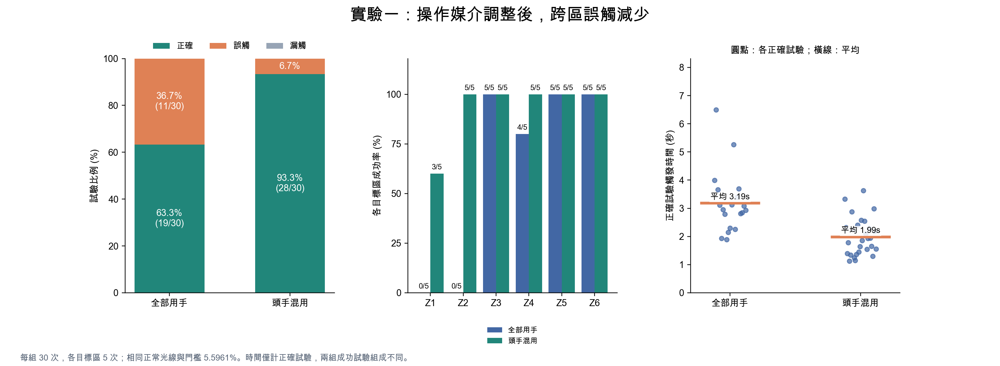
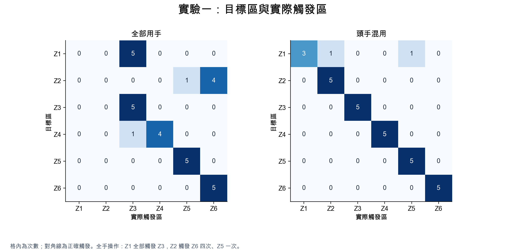
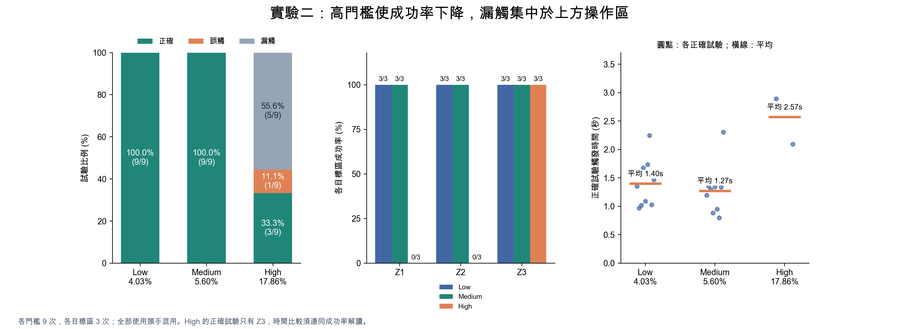
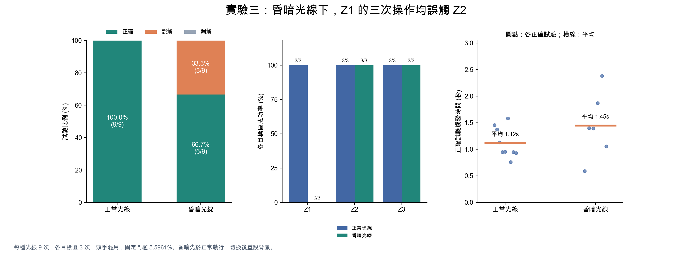

# HW4 實驗結果與討論

## 資料與指標定義

四份 CSV 共 105 次試驗：實驗一新增一組操作媒介比較，因此實驗一為 60 次，實驗二 27 次、實驗三 18 次。已核對各組次數、條件格數、trial_id 唯一性與結果旗標，未刪除任何試驗。實驗二與三均採 Z1／Z2 用頭，Z3–Z6 用手。

成功率為正確觸發次數／總試驗次數；誤觸指試驗中第一個觸發區與目標區不同，漏觸指逾時未觸發。誤觸率的分母為正式試驗次數，不代表無操作時的背景誤觸頻率。觸發時間從按下開始計時至偵測觸發，包含人的反應與動作時間，並非純演算法處理延遲。

時間表同時列出所有有觸發試驗（包含誤觸）及正確試驗的平均值。漏觸時間為缺值，不以 0 秒取代，也不當作成功觸發時間。motion ratio 在成功時是目標區觸發當幀的比例，誤觸時屬於錯誤觸發區，漏觸時是目標區在試驗內的最大比例；因此以下平均 motion ratio 僅計正確試驗。

## 實驗一：操作媒介的調整

| 條件 | n | 正確 | 成功率 | 誤觸 | 漏觸 | 所有已觸發平均秒 | 正確觸發平均秒 | 正確觸發中位秒 | 正確試驗平均 motion ratio |
|---|---:|---:|---:|---:|---:|---:|---:|---:|---:|
| 全部用手 | 30 | 19 | 63.3% | 11 | 0 | 2.773 | 3.193 | 2.948 | 9.659% |
| Z1／Z2 用頭，其餘用手 | 30 | 28 | 93.3% | 2 | 0 | 1.944 | 1.991 | 1.892 | 10.149% |

兩組均為正常光線、固定門檻 5.5961%、各指令五次。全手操作正確 19/30（63.3%），頭手混用正確 28/30（93.3%），增加 30.0 個百分點。誤觸由 11 次降為 2 次，減少 9 次（相對減少 81.8%）；兩組均無漏觸。

差異主要集中於閱讀區：全手操作的 Z1、Z2 各 0/5；混用後 Z1 為 3/5、Z2 為 5/5。全手操作 Z1 的五次均誤觸 Z3，Z2 的五次分別誤觸 Z6 四次與 Z5 一次，顯示上方目標操作常被下方工具列區域先觸發。

操作過程觀察到，使用手觸及上方 Z1／Z2 時，容易伴隨較大幅度的手臂及身體移動，使其他區域出現前景變化。改以頭部控制上方兩區後，本次記錄的誤觸次數減少。這個機制是測試者的質性觀察；CSV 能支持跨區錯誤的分布，沒有直接測量身體位移或每一幀各區變化，故不能單靠這些資料證明身體移動是唯一原因。

此結果說明背景減除能接受不同動作媒介：系統辨識的是前景變化，並沒有新增頭部或手部偵測。互動方式應配合鏡頭中身體位置、目標區高度與移動路徑設計。

### 各指令結果

| 條件 | n | 正確 | 成功率 | 誤觸 | 漏觸 | 所有已觸發平均秒 | 正確觸發平均秒 | 正確觸發中位秒 | 正確試驗平均 motion ratio |
|---|---:|---:|---:|---:|---:|---:|---:|---:|---:|
| 全部用手 Z1 | 5 | 0 | 0.0% | 5 | 0 | 2.054 | — | — | — |
| 全部用手 Z2 | 5 | 0 | 0.0% | 5 | 0 | 2.185 | — | — | — |
| 全部用手 Z3 | 5 | 5 | 100.0% | 0 | 0 | 3.699 | 3.699 | 3.113 | 10.246% |
| 全部用手 Z4 | 5 | 4 | 80.0% | 1 | 0 | 2.353 | 2.609 | 2.276 | 10.133% |
| 全部用手 Z5 | 5 | 5 | 100.0% | 0 | 0 | 3.158 | 3.158 | 2.793 | 10.270% |
| 全部用手 Z6 | 5 | 5 | 100.0% | 0 | 0 | 3.187 | 3.187 | 3.077 | 8.081% |
| Z1／Z2 用頭，其餘用手 Z1 | 5 | 3 | 60.0% | 2 | 0 | 1.325 | 1.354 | 1.147 | 8.475% |
| Z1／Z2 用頭，其餘用手 Z2 | 5 | 5 | 100.0% | 0 | 0 | 1.514 | 1.514 | 1.394 | 10.198% |
| Z1／Z2 用頭，其餘用手 Z3 | 5 | 5 | 100.0% | 0 | 0 | 1.807 | 1.807 | 1.855 | 12.072% |
| Z1／Z2 用頭，其餘用手 Z4 | 5 | 5 | 100.0% | 0 | 0 | 1.999 | 1.999 | 1.562 | 11.377% |
| Z1／Z2 用頭，其餘用手 Z5 | 5 | 5 | 100.0% | 0 | 0 | 2.850 | 2.850 | 2.880 | 9.438% |
| Z1／Z2 用頭，其餘用手 Z6 | 5 | 5 | 100.0% | 0 | 0 | 2.167 | 2.167 | 2.287 | 8.664% |

## 實驗二：門檻的影響

| 條件 | n | 正確 | 成功率 | 誤觸 | 漏觸 | 所有已觸發平均秒 | 正確觸發平均秒 | 正確觸發中位秒 | 正確試驗平均 motion ratio |
|---|---:|---:|---:|---:|---:|---:|---:|---:|---:|
| Low | 9 | 9 | 100.0% | 0 | 0 | 1.400 | 1.400 | 1.352 | 8.852% |
| Medium | 9 | 9 | 100.0% | 0 | 0 | 1.274 | 1.274 | 1.295 | 10.455% |
| High | 9 | 3 | 33.3% | 1 | 5 | 3.700 | 2.572 | 2.728 | 24.167% |

Low（4.03%）與 Medium（5.60%）皆為 9/9 正確、無誤觸與漏觸。High（17.86%）只有 3/9 正確，另有 1 次誤觸及 5 次漏觸；三次正確均為 Z3。Z1 在 High 為兩次漏觸、一次誤觸 Z5，Z2 的三次均漏觸。

High 的五次漏觸，其目標區最大 motion ratio 均低於 17.86%（約 11.41%–17.82%），支持門檻過高會排除本次自然操作的解釋。逐幀 motion ratio 未保存，無法進一步重建連續 K 幀的時間歷程。

Medium 的正確觸發平均時間低於 Low，但兩者各僅九次，這項小差異不足以宣稱 Medium 普遍較快或為最佳門檻；本次資料只能支持 Low／Medium 在目前操作條件下皆可用，而 High 不適合上方兩區。

| 條件 | n | 正確 | 成功率 | 誤觸 | 漏觸 | 所有已觸發平均秒 | 正確觸發平均秒 | 正確觸發中位秒 | 正確試驗平均 motion ratio |
|---|---:|---:|---:|---:|---:|---:|---:|---:|---:|
| Low Z1 | 3 | 3 | 100.0% | 0 | 0 | 1.283 | 1.283 | 1.352 | 7.675% |
| Low Z2 | 3 | 3 | 100.0% | 0 | 0 | 1.028 | 1.028 | 1.021 | 8.651% |
| Low Z3 | 3 | 3 | 100.0% | 0 | 0 | 1.888 | 1.888 | 1.736 | 10.230% |
| Medium Z1 | 3 | 3 | 100.0% | 0 | 0 | 1.008 | 1.008 | 0.884 | 8.676% |
| Medium Z2 | 3 | 3 | 100.0% | 0 | 0 | 1.167 | 1.167 | 1.194 | 10.835% |
| Medium Z3 | 3 | 3 | 100.0% | 0 | 0 | 1.648 | 1.648 | 1.345 | 11.855% |
| High Z1 | 3 | 0 | 0.0% | 1 | 2 | 7.084 | — | — | — |
| High Z2 | 3 | 0 | 0.0% | 0 | 3 | — | — | — | — |
| High Z3 | 3 | 3 | 100.0% | 0 | 0 | 2.572 | 2.572 | 2.728 | 24.167% |

## 實驗三：光線的影響

| 條件 | n | 正確 | 成功率 | 誤觸 | 漏觸 | 所有已觸發平均秒 | 正確觸發平均秒 | 正確觸發中位秒 | 正確試驗平均 motion ratio |
|---|---:|---:|---:|---:|---:|---:|---:|---:|---:|
| Normal Lighting | 9 | 9 | 100.0% | 0 | 0 | 1.119 | 1.119 | 0.953 | 13.631% |
| Dim Lighting | 9 | 6 | 66.7% | 3 | 0 | 1.288 | 1.448 | 1.396 | 15.453% |

正常光線為 9/9 正確，昏暗光線為 6/9 正確，下降 33.3 個百分點；兩種光線均無漏觸。昏暗的三次失敗皆為 Z1 誤觸 Z2，Z2 與 Z3 各為 3/3 正確，因此錯誤集中在左右閱讀區的區分，不能概括成所有指令都因昏暗而失效。

正確試驗平均觸發時間在昏暗條件較長，但昏暗條件排除了三次 Z1 失敗，兩組成功試驗的命令組成不同。應同時閱讀各指令表，不把整體平均時間當成同一批動作的純光線效果。背景模型在切換光線後重新學習，因此此實驗比較穩定後的正常／昏暗條件，不衡量調光瞬間的干擾。

| 條件 | n | 正確 | 成功率 | 誤觸 | 漏觸 | 所有已觸發平均秒 | 正確觸發平均秒 | 正確觸發中位秒 | 正確試驗平均 motion ratio |
|---|---:|---:|---:|---:|---:|---:|---:|---:|---:|
| Normal Lighting Z1 | 3 | 3 | 100.0% | 0 | 0 | 1.029 | 1.029 | 0.953 | 10.489% |
| Normal Lighting Z2 | 3 | 3 | 100.0% | 0 | 0 | 1.152 | 1.152 | 0.948 | 9.518% |
| Normal Lighting Z3 | 3 | 3 | 100.0% | 0 | 0 | 1.177 | 1.177 | 1.128 | 20.884% |
| Dim Lighting Z1 | 3 | 0 | 0.0% | 3 | 0 | 0.970 | — | — | — |
| Dim Lighting Z2 | 3 | 3 | 100.0% | 0 | 0 | 1.882 | 1.882 | 1.869 | 7.973% |
| Dim Lighting Z3 | 3 | 3 | 100.0% | 0 | 0 | 1.013 | 1.013 | 1.055 | 22.932% |

## 結果的適用範圍

這是同一測試者、同一設備與環境的探索性重複試驗，試驗次數不能視為獨立參與者數。全手組先於頭手混用組，可能存在練習、策略調整與時間順序效應；實驗三昏暗組先於正常組，也有順序效應的可能。未記錄照度、相機曝光參數、K 與 Cooldown 的逐次設定，無法由 CSV 確認其物理光線差異或所有控制變項。

本次新增的操作媒介比較是對發現問題後進行的探索性設計調整，應在報告中明確描述；實驗二與三僅針對調整後的頭手混用方式，結果不宜直接外推到全手操作。未進行顯著性檢定或宣稱普遍因果效果。後續可透過更多測試者、對調操作順序、固定攝影機位置、量測照度及保存逐幀區域數值，檢驗媒介調整能否穩定改善誤觸。

## 資料來源與重現

- [experiment1_20261106-全部用手.csv](../experiment1_20261106-全部用手.csv)

- [experiment1_20261106-z1z2使用頭_z3z4z5z6使用手.csv](../experiment1_20261106-z1z2使用頭_z3z4z5z6使用手.csv)

- [experiment2_20261106-z1z2使用頭_z3z4z5z6使用手.csv](../experiment2_20261106-z1z2使用頭_z3z4z5z6使用手.csv)

- [experiment3_20261106-z1z2使用頭_z3z4z5z6使用手.csv](../experiment3_20261106-z1z2使用頭_z3z4z5z6使用手.csv)

執行 `python analyze_experiments.py` 重新產生本報告、summary_metrics.csv 與四組 PNG／SVG 圖表；需安裝 matplotlib。原始 CSV 不會被修改。圖表時間分布只顯示正確試驗，橫線為平均值；各圖均標示分母，未繪製不適當的參與者信賴區間。